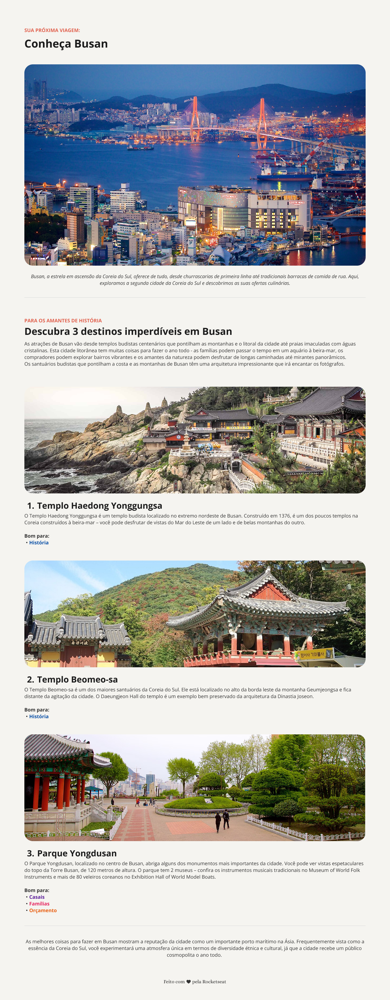

# Local Turístico · Conheça Busan


> **🧩 Desafio prático:** proposto pela **formação Full Stack da [Rocketseat](https://www.rocketseat.com.br/)**, que forneceu apenas o layout no Figma e a lista de requisitos. Todo o código (estrutura HTML e estilos CSS) foi desenvolvido por mim, sem acompanhamento de aula.

Landing page de turismo sobre **Busan, na Coreia do Sul**, com seção de destaque e três pontos turísticos. Feita apenas com HTML e CSS, com foco em estrutura semântica e em um layout organizado e agradável.

🔗 **[Ver projeto online](https://lpwesley.github.io/local-turistico/)**

## 📸 Prévia



## ⚙️ Funcionalidades

- Cabeçalho com o título principal da página
- Seção de destaque com imagem e texto de apresentação de Busan
- Seção com três pontos turísticos, cada um com imagem, título, descrição e link "Saiba mais"
- Imagens com bordas arredondadas e espaçamento consistente entre seções
- Rodapé com créditos
- Imagens em formato WebP, mais leves para carregar

## 🛠️ Tecnologias

- **HTML5:** estrutura semântica com `header`, `main`, `section`, `hgroup` e `footer`
- **CSS3:** tipografia, cores, espaçamentos e estilização das imagens
- **Git e GitHub Pages:** versionamento e publicação

## 📚 O que pratiquei

- Transformar um layout do Figma em página funcional
- Estruturar o conteúdo com HTML semântico
- Agrupar título e subtítulo com `hgroup`
- Organizar o CSS em arquivos por responsabilidade (`global`, `header`, `main`, `footer`)
- Otimizar imagens com o formato WebP

## 📂 Estrutura

```text
local-turistico/
├── assets/
│   ├── icons/
│   │   └── heart.svg
│   ├── images/
│   │   └── Image_01 a Image_04 (.png, .webp e -800.webp)
│   └── preview-local-turistico.png
├── css/
│   ├── footer.css
│   ├── global.css
│   ├── header.css
│   ├── main.css
│   └── style.css
├── index.html
└── README.md
```

## 💻 Como executar

Não há dependências. Basta clonar e abrir no navegador:

```bash
git clone https://github.com/lpwesley/local-turistico.git
cd local-turistico
```

Abra o `index.html` no navegador ou use a extensão **Live Server** no VS Code.

## 🎓 Créditos

Desafio e layout propostos pela **[Rocketseat](https://www.rocketseat.com.br/)** como parte da formação Full Stack. A implementação foi feita por mim. Textos e imagens de Busan usados apenas para fins de estudo.

---

Desenvolvido por **Wesley Lauwer** · [GitHub](https://github.com/lpwesley)
